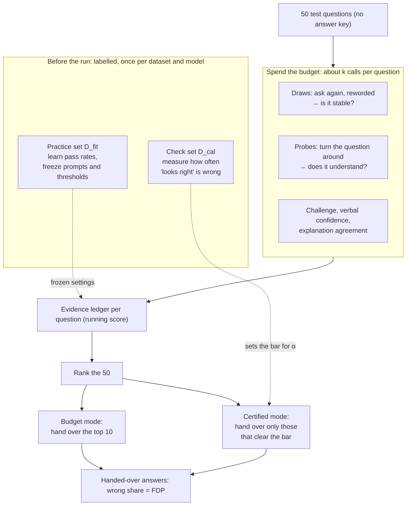
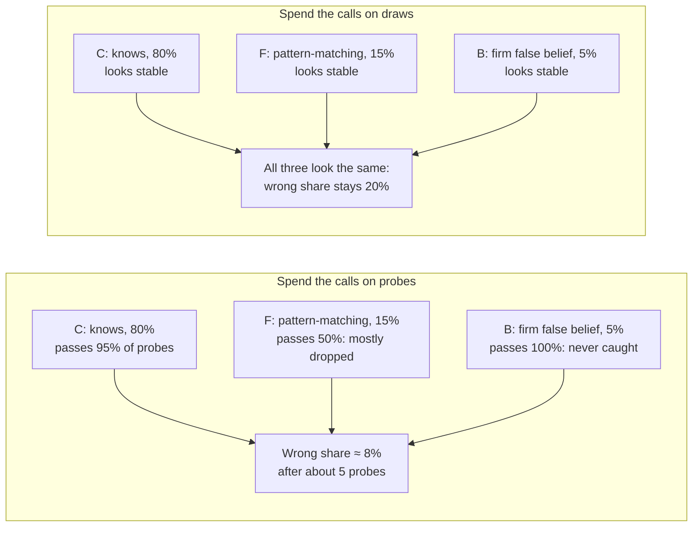

# Problem setup

Status: draft, 2026-10-12. Written in the style of the problem setup of Gui, Jin & Candès
(2024), "Conformal Alignment" (see `reference.md`), adapted to CEL. Part 1 is paper prose;
Part 2 is a plain-language version with diagrams. Where the draft says what is and is not
in the code yet, it says so.

---

## Part 1. Formal setup (paper draft)

Suppose we have a pre-trained language model $f : \mathcal{X} \to \mathcal{Y}$ that maps a
prompt to an answer. Throughout, we view the model as given, fixed and **black-box**: we
can only sample from it, with no access to token probabilities, gradients or weights. A
single call $f(x)$ at a fixed temperature returns a random answer, so the same prompt can
produce different answers on different calls.

**Cases and correctness.** A case is a question $X \in \mathcal{X}$ with a binary answer
$Y \in \{0, 1\}$. For a case, write $\hat Y$ for the model's majority answer and
$Z = \mathbb{1}\{\hat Y = Y\}$ for its correctness. The target of inference is $Z$, not $Y$:
we want to know whether the model is right, not what the right answer is. $Y$ is never
observed for test cases.

**Calls and evidence.** To learn about a case we may spend API calls on it. Each call
applies a transformation $g$ from a fixed battery $\mathcal{G}$ to the question and records
whether the model's response is consistent with $\hat Y$:

- *draws*: the question again, or a meaning-preserving paraphrase of it;
- *probes*: label-action transformations whose consistent response differs from a
  surface cue, e.g. negation (the consistent answer flips), relabelling of the options,
  or an added distractor;
- *other signals*: a challenge ("are you sure?"), verbalised confidence, and agreement of
  the model's explanations.

Each call yields a pass/fail outcome $b \in \{0, 1\}$. The record of all calls made on case
$j$ is its *evidence* $E_j$. A *policy* $\pi$ decides, possibly adaptively, which call to
make next on which case and when to stop. Its cost is the number of calls it makes.

**Labelled reference units.** We assume access to a small set of labelled holdout units
$\mathcal{D} = \{(X_i, Y_i)\}_{i=1}^{n}$, exchangeable with the test cases, on which the same
calls can be made. $\mathcal{D}$ is split into a fitting part $\mathcal{D}_{\mathrm{fit}}$
($n_{\mathrm{fit}}$ units), used to freeze prompts and thresholds and to estimate how often
correct and incorrect answers pass each kind of call, and a calibration part
$\mathcal{D}_{\mathrm{cal}}$ ($n_{\mathrm{cal}}$ units), used only to measure the error rate
of the frozen score. Nothing is tuned on test cases.

**Selection.** For a test batch $\mathcal{D}_{\mathrm{test}} = \{X_{n+j}\}_{j=1}^{m}$ and a
budget of $\bar k$ calls per case on average (total $B = \bar k\, m$), the policy collects
evidence $E_{n+1}, \dots, E_{n+m}$ and outputs a subset $\mathcal{S} \subseteq [m]$. The
selection is a function of the evidence (and of $\mathcal{D}$) only, never of the test
labels. The error is measured by the false discovery rate

$$
\mathrm{FDR} = \mathbb{E}\left[\frac{\sum_{j \in [m]} \mathbb{1}\{Z_{n+j} = 0,\ j \in \mathcal{S}\}}{\max(|\mathcal{S}|, 1)}\right],
$$

the expected share of selected answers that are wrong. The quantity inside the expectation
is the false discovery proportion (FDP). As in Gui et al., we also want as many correct
answers as possible to be selected:

$$
\mathrm{Power} = \mathbb{E}\left[\frac{\sum_{j \in [m]} \mathbb{1}\{Z_{n+j} = 1,\ j \in \mathcal{S}\}}{\max\left(\sum_{j \in [m]} \mathbb{1}\{Z_{n+j} = 1\}, 1\right)}\right].
$$

**Two operating modes.** The same evidence serves two goals.

1. *Budget mode (CEL-$k$).* Given $\bar k$ calls per case and a fixed size $|\mathcal{S}| = K$
   ($K = 5$, the top $10\%$ of $m = 50$), maximise $\mathbb{E}[\#\{j \in \mathcal{S} : Z_{n+j} = 1\}]$,
   equivalently minimise $\mathbb{E}[\mathrm{FDP}]$ at size $K$. This mode needs no labels at
   selection time; by Proposition 1, ranking by a score whose accuracy is monotone in the
   score is optimal.
2. *Certified mode (adaptive CEL).* Given a level $\alpha \in (0,1)$, enforce
   $\mathrm{FDR} \le \alpha$, and, under that constraint, maximise power while spending as
   few calls as possible. Two routes give the guarantee: a model-based one (the evidence
   ledger with e-BH, valid if incorrect answers pass each call no more often than the
   upper bound estimated on $\mathcal{D}_{\mathrm{fit}}$), and a distribution-free one
   (conformal p-values from $\mathcal{D}_{\mathrm{cal}}$ with BH, Jin & Candès 2023, valid
   for any score under exchangeability). *Code status: both routes are implemented
   (`certified_selection.py`, decisions.md #17), on the score fitted on
   $\mathcal{D}_{\mathrm{fit}}$ (`score_model.py`); the per-case truncated SPRT with fixed
   paper constants (`sprt_posterior.py`, Cor. 1) remains as well.*

As in Gui et al., the certified mode puts error control first: a wrong answer passed on as
trustworthy is the costly mistake, and a weak score should cost deliveries, not errors.

**What differs from conformal alignment.** (i) The alignment score is binary correctness,
$A = Z$, so the threshold $c$ is trivial. (ii) The features are not free: every piece of
evidence is an API call, so the score is bought under a budget, and how to spend the budget
(draws versus probes) is part of the problem. (iii) The model is black-box: there are no
logits or embeddings to build the score from.

**Main structural fact.** Within the pool of stable cases, draws see only how stable an
answer is, and stable answers can be wrong for two reasons: following a surface cue (type F)
or holding a consistent false belief (type B). Any policy that uses draws alone, with any
number of draws, has $\mathbb{E}[\mathrm{FDP}] = \rho$, the share of stable-but-wrong cases.
Probes catch type F and push the FDP below $\rho$, but not type B (the separation theorem,
`separation_theorem.md`).

### Notation

| Symbol | Meaning |
|---|---|
| $f$ | black-box LLM under test (gpt-4.1) |
| $X, Y$ | question, true binary answer |
| $\hat Y,\ Z = \mathbb{1}\{\hat Y = Y\}$ | majority answer, its correctness (the target) |
| $\mathcal{G}$ | battery of call types: draws, probes, challenge, verbal, rationale |
| $E_j$ | evidence for case $j$: all calls made and their pass/fail outcomes |
| $\mathcal{D} = \mathcal{D}_{\mathrm{fit}} \cup \mathcal{D}_{\mathrm{cal}}$ | labelled holdout units ($n = n_{\mathrm{fit}} + n_{\mathrm{cal}}$) |
| $\mathcal{D}_{\mathrm{test}}$, $m$ | test batch and its size (50) |
| $\bar k$, $B$ | calls per case, total budget $B = \bar k m$ |
| $\mathcal{S}$, $K$ | selected set, its size in budget mode (10) |
| $\alpha$ | FDR level in certified mode |

---

## Part 2. In plain language

### The situation

You have an assistant (the LLM) that answers 50 yes/no questions. You have no answer key
for these 50. You want to hand 10 of the answers to someone who will act on them without
checking, so you want those 10 to be right.

You are allowed to ask the assistant follow-up questions, but each one costs money
(one API call). You have a limited budget, roughly a few calls per question.

### What a follow-up question can tell you

| You ask | What you learn | What it cannot tell you |
|---|---|---|
| The same question again, or reworded (a **draw**) | Whether the assistant gives the same answer every time (is it **stable**?) | Whether a stable answer is right |
| The question turned around, e.g. "Is it false that ...?" (a **probe**) | Whether the assistant understood the question or is reacting to a word in it | Whether a confidently held wrong fact is wrong |
| "Are you sure?", "How confident are you?" | How the assistant reacts to pressure; what it says about itself | Not much on its own; used as extra signals |

### Three kinds of stable answers

Among the answers the assistant gives the same way every time, there are three kinds:

- **C, it knows**: it works out the answer, so it also handles the turned-around question.
- **F, it is pattern-matching**: it latches onto a cue in the wording. Asked again, it repeats
  itself, so draws can't see the problem; turned around, it often stumbles, so probes catch it.
- **B, it firmly believes something false**: it repeats itself and handles the turned-around
  question too. Nothing in your toolbox catches this one.

So asking the same thing again and again stops helping once an answer is stable: the wrong
share among stable answers stays at whatever it is (20% in the paper's example). Spending
some of those calls on probes removes most of the F answers, which brings the wrong share
down (to about 8% in the example). The B answers set the limit.

### Why you need a small answer key anyway

You never need the answer key for the 50 questions you are choosing from. But you do need a
small, separate set of questions where you *do* know the answers:

- **Practice set** (fitting): to learn how often right and wrong answers pass each kind of
  follow-up question, and to fix the prompts and thresholds before the real run.
- **Check set** (calibration): to measure, on fresh questions, how often an answer that looks
  this trustworthy is actually wrong. That measurement is what lets you promise "at most 5%
  of what I hand over is wrong".
- **Exam** (evaluation): to measure, for the paper, how well the method did. Its answers are
  only used to grade, never to choose.

### The two ways to use it

- **"I have this much money; give me the best 10."** Spend about $k$ calls per question and
  hand over the 10 best-looking answers. No promise on the error, just the best guess for the
  money (CEL-$k$).
- **"Give me only answers you can vouch for, at most 5% wrong."** Keep asking follow-ups until
  answers are either vouched for or dropped. You may hand over fewer than 10, but the 5%
  promise holds (adaptive CEL).

### Diagram: one batch, end to end

### Diagram: why draws hit a floor and probes do not

Numbers are the illustration values from `separation_theorem.md`, not estimates.
