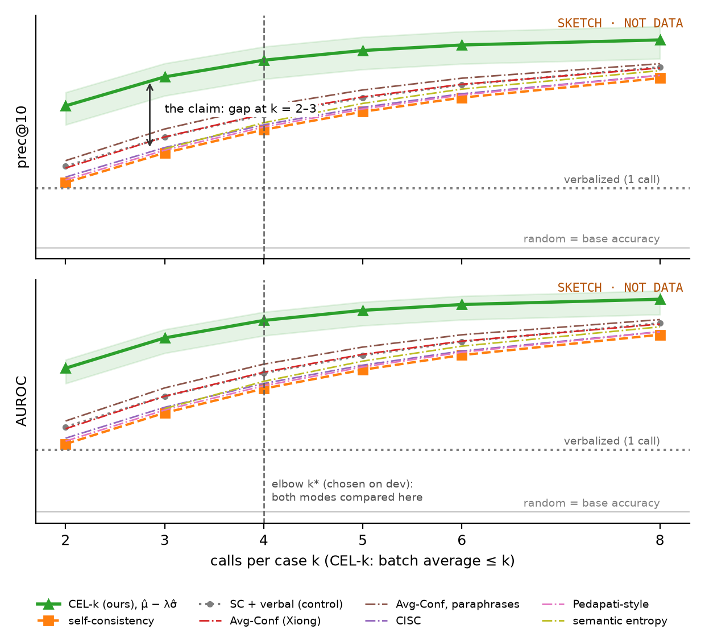
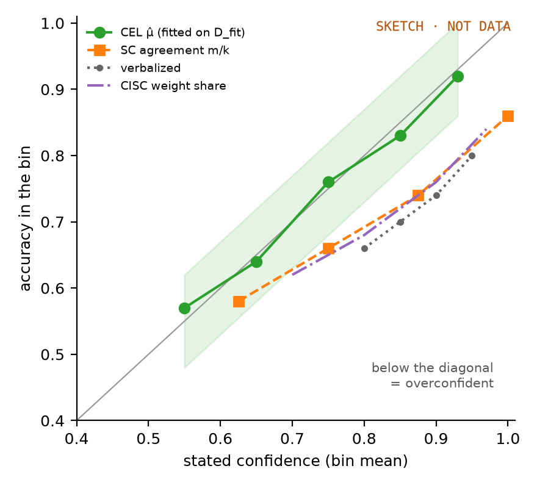
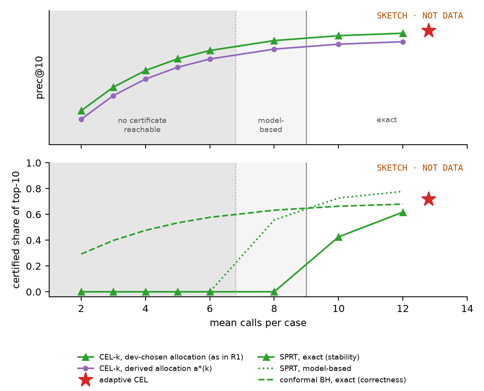

No real data has been collected yet: every figure is a sketch of the pre-registered
prediction (*SKETCH · NOT DATA*, no values on the quality axes). Each result is computed per
(dataset, model) cell on 500 eval items, 10 batches of 50, the top 10% (5 cases) per batch; everything is
fitted on the dev slice. The two modes are defined in `method.md`.

# R1. Budget curve (CEL-k, ranking mode)

{width=85%}

prec@10% and AUROC against calls per case. CEL-k (dev-chosen plan, ranked by μ̂ − λσ̂) spends
k on average over a batch; every baseline spends exactly k. The claim is the gap at k = 2–3,
and the deciding comparison is self-consistency + verbal confidence, the control (H3). The elbow k* is picked on the
dev curve, never on eval.

# R2. Metrics table at the elbow (both modes)

At k*, CEL-k and every baseline: prec@10%, calls, accuracy, AUROC, AUARC, Δ vs CEL-k, and
conformal power at FDR α = 0.1 (`elbow.tex`). Certified CEL sits beside them at its own
spend, since the SPRT sets it, with its certified share (`elbow.tex`, `main_ladder.tex`,
`certified.tex`). The single confirmatory test, CEL against matched self-consistency, is in
`confirmatory.tex`.

# R3. Calibration (ranking mode)

{width=50%}

Reliability of every score that claims to be P(correct), at k = 3 and at the matched budget.
μ̂ should sit on the diagonal; verbal confidence and agreement should be overconfident, worst
where stable-but-wrong answers pile up.

# R4. Mode linkage

{width=78%}

CEL-k as k grows, and certified CEL as a point. Bottom: the share of the top 10% that is
certified. The SPRT certificate is zero below its budget B* and rises after it; conformal
control works at every k. The CEL-k curve should meet certified CEL at its mean spend.

# Appendix A. Task-specific signal importance

Which signals carry confidence, and whether that depends on the task. Per (dataset, model)
cell, the score model is fitted on D_fit with every signal bought, and each signal's SHAP
importance is I_g = mean |β_g (x_g − mean x_g)| in log-odds, with a bootstrap 90% interval
over D_fit refits (`signal_value.py`). Reported as each signal's share of the total, one
panel per dataset, and as ranks with Kendall τ between datasets: a low τ means the signal
ranking is task-specific. Model-based (one fitted
model, signals treated as independent); the coalition Shapley on prec@10%
(`signal_effects.py`) is the audit. Outputs: `signal_importance_<model>.pdf`,
`signal_importance.tex`.

